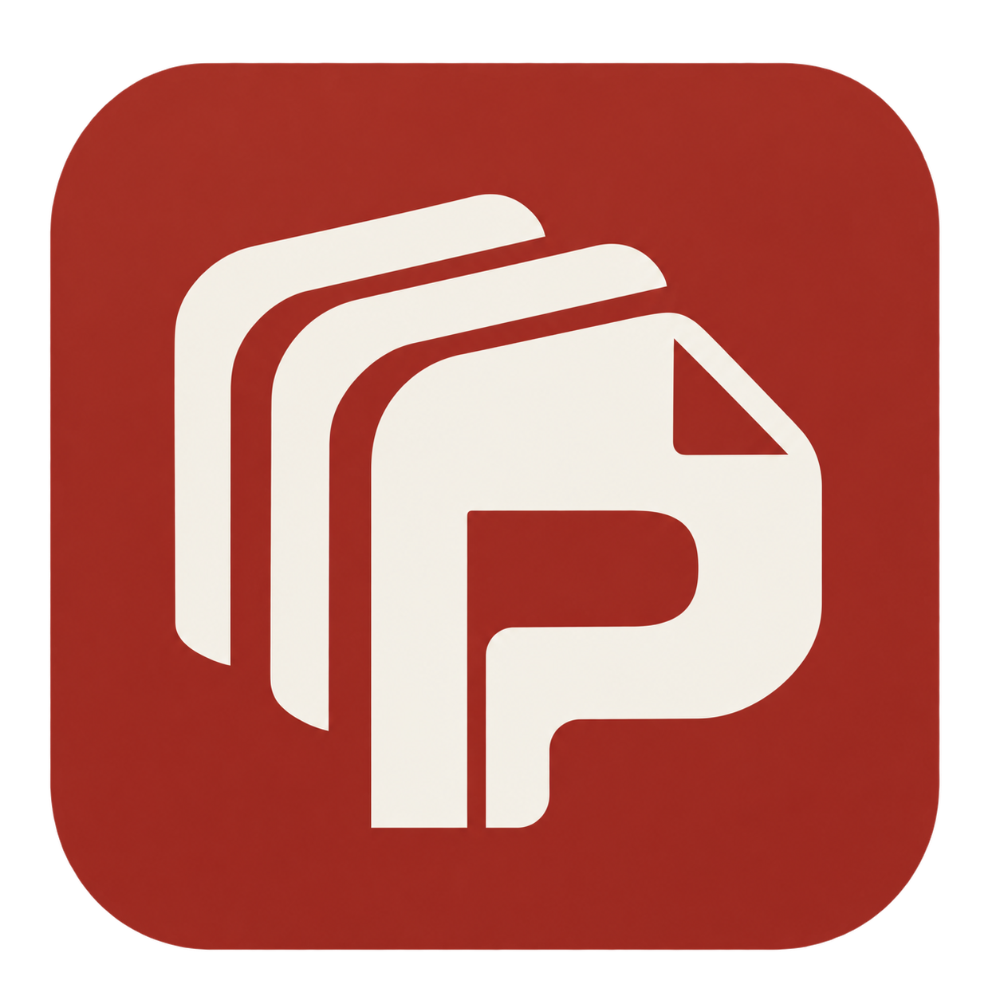

# 批印坊 PrintPress



> 一张样板，处理整批照片；一套模板，生成整份名单的成品。

批印坊是一款面向证书、奖状、胸卡、人像卡片和桌牌的 **Windows 本地智能批量制作工具**。导入名单与照片，确定一张样板的效果，再把处理规则和排版应用到整批记录，最后统一检查、导出或打印。

**当前源码版本：v0.6.9 · Windows x64 · MIT**

[下载安装](https://github.com/Chandlersn/Print-Workshop/releases/latest) · [使用说明](docs/使用说明.md) · [底图制作指南](docs/底图制作使用说明.md)

## 从一张样板，到整批成品

照片尺寸不统一、人物有大有小、背景需要去除、每个人的信息还要分别排版——这些重复工作可以交给一套批量流程。

| 环节 | 你需要确定的内容 | 批印坊完成的工作 |
| --- | --- | --- |
| 导入名单 | Excel / CSV，以及需要打印和配图的列 | 读取名单，按姓名、编号或文件名匹配照片 |
| 制作照片样板 | 尺寸、取景、抠图、人物对齐与柔边效果 | 按规则逐张处理，保留原始照片 |
| 设计版面 | 固定底图、变量照片框和文字字段 | 随记录更换姓名、编号、照片等内容 |
| 集中检查 | 批量查看效果，修正少数特殊照片 | 汇总缺图、处理失败、清晰度和裁切提示 |
| 批量输出 | 输出范围、分辨率与格式 | 生成 PDF、逐条图片或送往打印机，并保存任务记录 |

没有人物照片的证书、奖状等任务，可以直接从名单和模板开始。

## 智能批量处理

**用样板统一整批照片。** 在「变量照片」页选一张照片，设置统一画幅和等比适配，可叠加人像抠图、人物大小与眼睛高度对齐、底部渐隐和边缘羽化。每张照片独立计算人物蒙版，再使用相同规则生成自己的结果。

**让下一批接着用。** 规则可以保存为命名样板；保存模板时，也会附带当前已应用的照片规则。换名单后载入样板或模板规则即可复用。开启「自动沿用」后，新导入或更换的照片会按已应用规则处理，已有结果继续复用。自动处理的进度和失败原因可见，重启后会继续检查待处理照片。

**统一处理，允许单人例外。** 在批量检查中打开某一人的照片，可以单独调整取景、柔边等参数，也能用现有图片编辑器裁剪、修补背景或恢复误删主体。修改按人员记录保存，即使多人共用同一张原图，也只影响选中的人；可随时恢复统一样板。

**出片前看整批效果。** 检查页支持原图、处理后和套用模板三种视图，可搜索人员、筛选问题及单独修改的记录。套用模板复用实际打印排版；打印中心集中显示照片不可用、清晰度不足和人物裁切等提示。处理未完成或结果损坏时会阻止使用错误结果出片。

## 本地模型，照片留在本机

| 本地模型 | 作用 |
| --- | --- |
| [MODNet](https://github.com/ZHKKKe/MODNet) | 生成人像透明蒙版，用于去背景和柔边处理 |
| [YuNet](https://github.com/opencv/opencv_zoo/tree/main/models/face_detection_yunet) | 检测人脸与眼睛位置，用于统一人物大小和眼睛高度 |

完整桌面包包含模型，使用 ONNX Runtime 在本机 CPU 上运行，无需配置独立显卡，也无需上传照片或填写云服务密钥。模型许可及来源见 [模型说明](build/models/NOTICE.txt)。

自动处理以单人照片为主。未识别人脸或检测到多人时，人物对齐会保留普通适配并提示检查；发丝、相近背景和复杂边缘仍可能需要手工修补。人物对齐调整大小与位置，不自动修正歪头，也不等同于证件照合规认证。

## 三种编辑，影响范围清楚

| 在哪里编辑 | 影响谁 |
| --- | --- |
| 变量照片页：样板设置 | 当前名单中使用统一规则的照片 |
| 变量照片页：单张编辑 | 当前人员的照片，其他记录保持原来的规则 |
| 底图制作：参考样图 | 仅供排版参考，不打印，也不改变整批照片 |

底图中的参考样图直接使用普通图片工具，无需学习另一套编辑器。实际输出的位置、尺寸和取景由保留名单绑定的变量框控制；参考图可以隐藏、删除或重新取样。

## 排版、输出与复用

底图支持图片、固定文字、形状和图层排版，也可以导入 PSD / PSB，在转换报告确认后继续制作。姓名等文字字段和变量照片在输出时按名单替换，支持单页、多联、对折以及选人补打。

照片批量处理、模板预览、PDF 和图片输出使用同一份处理结果。打印历史保留任务与内容快照，便于回看和补打；底图工程可通过 `.ppdesign` 工程包转移。PSD 的字体、混合效果及特殊图层可能需要转换，导入后应检查画面；外部字体软件联动尚未接入。

## 开始使用

1. 从 [Releases](https://github.com/Chandlersn/Print-Workshop/releases/latest) 下载 Windows 安装包并安装。
2. 在「数据」页导入名单，打开需要打印的列；有照片时，再开启一列「配图」。
3. 在「变量照片」页导入照片、制作并应用样板，按需开启自动沿用。
4. 在「底图制作」和「模板」页确定版面，保存模板。
5. 先做批量效果检查，再到「打印中心」预览并输出。

安装包目前未签名；下载后可与 Release 中的 `SHA256SUMS.txt` 核对。首次使用可先用示例名单体验，详细步骤见[使用说明](docs/使用说明.md)。

## 数据与离线使用

名单、照片、模板和任务记录默认保存在 `%APPDATA%\printpress\data`，可在应用中更改数据目录。制作、模型推理和输出可离线使用；版本检查与安装更新会联网访问 GitHub。应用不会将制作数据上传到设计服务。

备份时保存完整数据目录；如果另外配置了 `PRINTPRESS_ASSET_DIR` 素材目录，也应一起备份。工程包转移底图与其素材，完整名单和人员照片的迁移以数据目录备份为准。

## 开发与自动化

```powershell
npm ci
npm run electron:dev
```

构建前端与 Windows 桌面包：

```powershell
npm run build
npm run dist
```

桌面产物位于 `release/`。本地模型位于 `build/models/`，打包时随应用复制；请保留模型及其许可文件。

界面、命令行与 MCP 共用领域能力注册表，当前提供 **109 个操作**。可用于脚本批量导入、查询、验证和出片，操作清单以运行结果为准：

```powershell
node bin/pp.cjs ops
npm run mcp
```

写操作需要显式授权；桌面应用占用数据目录时，独立 CLI 保持只读，避免两个进程覆盖数据。命令行与脚本用法见 [使用说明](docs/使用说明.md)及 [bin/pp.cjs](bin/pp.cjs)。

质量验证包括 **57 个测试套件**，以及真实桌面图片编辑、照片自动处理、批量排版和 PDF 输出检查：

```powershell
npm test
npm run build
npm run test:photo-processing-e2e
npm run test:image-edit-e2e
npm run test:photo-e2e
npm run test:fixed-image-dedupe-e2e
```

真实打印效果仍取决于打印机、纸张和驱动设置，正式批量打印前请先试打一页。

## 文档与反馈

- [使用说明](docs/使用说明.md)：从导入到批量输出的完整操作。
- [底图制作使用说明](docs/底图制作使用说明.md)：图层、参考样图、工程保存与迁移。
- [不变量契约](docs/不变量契约.md)：数据与输出行为的约束。
- [问题反馈](https://github.com/Chandlersn/Print-Workshop/issues)：附上操作步骤、提示和软件版本。

代码采用 MIT 许可。本地模型按各自许可分发。
