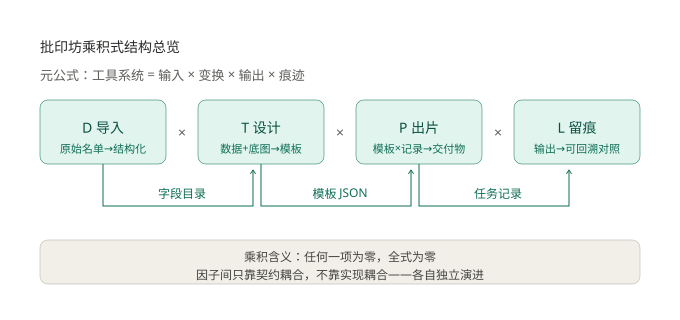
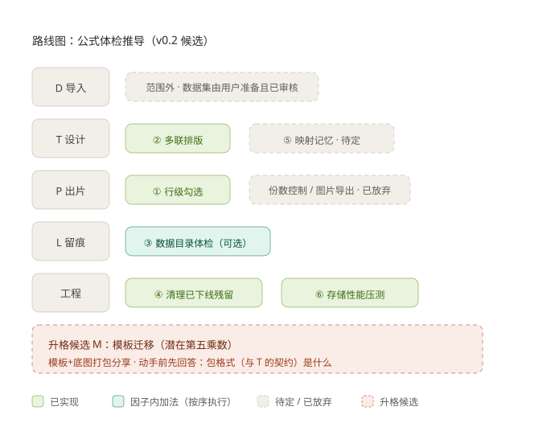

# 批印坊第一性原理：乘积式结构总纲

> 最值钱的开发源头，是把工具系统写成一条公式。需求来了先定位到因子，再决定加法还是新乘数——思路和结构划分，一眼明了。

## 一、元公式（一切工具系统）

```
工具系统 = 输入 × 变换 × 输出 × 痕迹
```

任何「帮人把一件事批量做完」的工具，都能拆成这四个乘数。乘积的含义：**任何一项为零，全式为零**——没有输入的变换是空转，不留痕迹的输出不可回溯。

## 二、批印坊的展开

```
批印坊 = 导入 D × 设计 T × 出片 P × 留痕 L
```



| 因子 | 内部公式 | 已完成的加法 |
|------|----------|--------------|
| **D 导入**（原始名单→结构化数据） | D = 解析 × 结构化 × 激活 | 多编码识别、Excel 多表拆/合、单元格编辑、印开关 |
| **T 设计**（数据+底图→排版模板） | T = 底图纸张 × 字段映射 × 排版绑定 | 纸张族 A3/A4/A5、吸附/均分横排、撤销重做、字体管理 |
| **P 出片**（模板×记录→交付物） | P = 出口校验 × 渲染 × 输出 | 空值直达补录、缺失阻断、无裁边预览、PDF/直打 |
| **L 留痕**（输出→可回溯的对照） | L = 快照归档 × 状态回写 × 统计 | 月度归档、历史重打/删除、已打变色、统计条 |

## 三、乘积结构的工程含义

**因子之间只通过契约耦合，不通过实现耦合**——这是乘积式拆分的全部意义：

```
D --字段目录--> T --模板JSON(含绑定)--> P --任务记录--> L
```

- D→T 契约：字段目录（从数据集真实记录派生，印开关过滤）
- T→P 契约：模板 JSON（底图/字段/几何/绑定数据集）
- P→L 契约：任务记录（jobId、快照路径、份数）

于是每个因子可以独立演进：T 内部怎么改吸附算法，D 和 L 无感知。测试同样按因子切（每因子一个套件），契约由 matchFields 这类纯函数把守。

## 四、加法规则（什么能加，怎么加）

1. **因子内加法（白名单，随时可做）**：新纸张往 PAGE_SIZES 加一项、新格式加解析器、新对齐工具、新输出方式——不动公式、不动契约，测试补一条即可。
2. **因子级新乘数（升格，需重审契约）**：某因子的内部环节长成独立能力时升格，如「统计」从 L 的内部环节升为独立呈现。升格 = 动总览公式，必须先回答：它和相邻因子的契约是什么？
3. **反模式（结构破坏）**：跨因子的快捷路径——比如打印中心直接改数据、渲染引擎绕过模板读原始 CSV。任何「抄近道」都会让乘积退化成一团乱麻，下一轮迭代还债。

## 五、不变量（乘积守恒项，因子怎么加都不许破坏）

- 数据不出本机
- 入口宽松，出口把关
- 单一权威定义源
- 卡点可见（现象 + 原因 + 出口）
- **留痕必全，状态只认全量**——每一次出片（含部分）都必须留痕；但数据集级「已打」状态**只由全量出片回写**。部分出片若回灌，会让「打了 3 个人」显示成「整份已打」，信号失真、判断被带偏

## 六、这套方法的用法

新需求到手，三步定位：

1. 它属于哪个因子？（或都不属于 → 想清楚要不要新乘数）
2. 因子内加法还是因子间契约变更？
3. 契约动了，哪些相邻因子和测试要跟？

——而不是「先写代码再说」。结构划分一眼明了，是乘积式总览唯一的 KPI。

## 七、公式体检（v0.1.0 现状，逐因子找「弱项」）

乘积式结构最大的用处：**缺什么一目了然**。逐因子检查内部公式的每个乘数，找「趋零项」和「摩擦点」。

**范围界定（体检前先划边界）**：本工具的前提是用户已持有**经审核的数据集**与模板；职责边界 = **快速简单地做好模板 + 批量化出片 + 细节补充**。边界之外的环节即使「缺」，也不记为弱项——避免把不归自己管的事当成待办。

| 因子 | 健康 | 弱项 / 摩擦点 |
|------|------|---------------|
| D 导入 | 乘数齐（解析/结构化/激活均有实装） | 无（数据集由用户准备且已审核，管理面不在职责内） |
| T 设计 | 排版绑定最厚实（换绑 + 字段匹配预检 + 多联拼版均已实装） | 换绑需精确匹配，按列 key 自动重映射（映射记忆）未做——模板与数据集多为固定搭配，收益待验证 |
| P 出片 | 出口校验三层最完整 | 粒度只有「全量出片」（`buildPayload` 恒全量）——缺**行级勾选**（补打 / 分批）与**份数控制**，两者均已定为待做项 |
| L 留痕 | 快照/回写/统计闭环 | 底图孤儿**主路径已堵**（删模板连带清理，见 `deleteTemplate`）；仅历史遗留 / 手动残留无扫描入口，属可选体检 |

契约健康：三条契约都由纯函数把守（matchFields / 模板 JSON / 任务记录），无跨因子捷径。结构未破坏。

## 八、路线图（从公式推导，不拍脑袋）



**进度**：① 行级勾选、② 多联/双联排版、④ 清理已下线残留、⑥ 存储性能压测**均已实现**（2026-10-01；12 套件 339 项领域测试 + 2 条 CDP 真机 e2e），③ 数据目录体检（可选）与 ⑤ 映射记忆（待定）未做。

体检结论直接翻译成候选，按「因子内加法 vs 细节补充 vs 升格」分档，价值排序：

**因子内加法（契约不动，随时可做）**

1. **P：行级勾选**（已实现）——默认**全选**（全量出片仍是主路径）；可「取消全选」后按关键词查询、逐个勾选，用于**补打 / 分批**。**同一份勾选统一作用于「直接打印」与「导出 PDF」两个出口**——不做两套范围，出片范围由用户自己决策。
   - **回写规则（防混淆，见不变量「留痕必全，状态只认全量」）**：只有「本次范围 = 全部行」才调用 `markPrinted` 回写数据集状态（侧栏「已打」徽标 / 变色）；**部分出片一律不回写，但照常留痕**。判定用「行数覆盖」，不做逐行状态持久化（行会漂移）。现有 `print:exportGrouped`（分组导出）已遵循同一规则，可作先例。
   - 任务记录加 `rows` 字段（索引集合，向后兼容）；勾选是**一次性 UI 状态**（打完即弃），数据集变更时失效重选——不持久化。查询复用现成 `columnValues`。
2. **T：多联/双联排版**（已实现）——一页多记录（N-up 拼版）。**语义转变**：底图从「整页一张」变为「**单个成品图**」，系统按纸张与成品尺寸**自动算出行列数**（如 A4 放 2 列 × 5 行），用户只在**版式预设**上微调——不做手工拼网格，守住「快速简单」定位。render-engine 按 M×N 切块分页、输出契约不变；另需**裁切线**辅助手工裁切。
3. **L：数据目录体检（可选）**——删模板已连带清理底图（`deleteTemplate` 内的引用判断 + unlink），主路径无泄漏；仅历史遗留 / 手动残留底图与失效快照无扫描入口。优先级下调为「有需要再做」。
4. **工程卫生：清理已下线功能残留**（已实现）——按「快速简单」原则**全删净**：`print:exportGrouped` 整条链路（IPC handler + preload 暴露）、`dataset.columnValues` + `catalog:values`、打印通道的 `filters` 参数、以及 `rows.cjs` 的 `applyFilters`（该文件收缩为 `placeholder.cjs`，只留 `isPlaceholder`）。`modeLabel` 的「分组导出（已下线）」映射保留（1 行，防历史记录裸奔）。详见开发经验总结。

**细节补充（贴合「微调与细节补充」定位，待真实需求驱动）**

5. **T：映射记忆**——换绑本身**已实现**（`rebindDataset` + `matchDataset` 预检，字段缺失即阻断）；缺的是**按列 key 自动重映射同名字段**（免手工重摆）。模板与数据集若为固定搭配则收益有限，**视真实换绑频率再定**；动手需动 D→T 契约（字段目录携带稳定 key 语义），matchFields 同步扩展。

**工程体检**

6. **存储性能压测**（已实现）——实测结论：**「5 万行」阈值偏保守，可放宽到 10 万行 / 20MB**；任务的 O(n²) 在真实使用中不存在（一次打印才建一条）；真正瓶颈是「整文件重写」机制而非 JSON 格式；且**「升 SQLite」与项目「零原生依赖」原则冲突**，真要上应等 Electron 内置 Node ≥22 用 `node:sqlite`。详见 `docs/存储性能基准.md`。

**升格候选（动总览公式，先答契约再动手）**

7. **M 模板迁移**：模板 + 底图打包导出/导入，让模板可以分享给其他人。这是潜在第五乘数——动手前必须先回答：包格式（它和 T 的契约）是什么？底图版权如何声明？
   升格判据：当「分享模板」从个人便利变成多用户刚需时升格，v0.1 阶段只记账不动手。

**已跳过 / 已放弃（本轮决策，留档备查）**

- **份数控制**（2026-10-01 **跳过**）——「每人 N 份」经确认非真实需求，本轮不做，也不预留 `copies` 契约位。
- **图片导出（模板效果图）**（2026-10-01 **放弃**）——技术受阻：窗口内容尺寸被系统钳制在屏幕工作区内，A4 竖版整页（1123 CSS px 高）塞不进窗口；CDP `Page.captureScreenshot` 稳定挂死；离屏模式同样被钳制且 `paint` 取帧崩进程。分块截图 + canvas 拼接能出正确整页图，但同进程连续导出存在未解阻塞，性价比不成立。
  **注意**：该项属 **T 因子**（在模板工坊导出模板效果图），不是 P 因子出片通道——此前记账有误。

**明确不做 / 移出范围**

- **数据集管理面（重命名 / 复制 / 导出 CSV）**——数据集由用户准备且已审核，不属于本工具职责（注意：「行级勾选」管的是**出片范围**——打印与导出 PDF，不是数据集导出）；
- 行级打印状态持久化——行会漂移，标记必失真，违反 L 的守恒（痕迹必须可信）；
- 云同步/账号体系——违反不变量「数据不出本机」，除非整个产品定位推翻重来；
- 自更新全自动化——对单机离线工具，自动下载安装的复杂度与收益不成正比，降级为「下载页直达 + 版本对比」。

## 九、一句话

> 公式是审计工具，不是装饰：体检找弱项，路线从弱项推导，每项先归档（因子/契约/升格）再动手。
> 范围铁律：数据集与模板由用户准备并已审核，本工具只在「快速做模板 + 批量化出片」上做加法，不越界做数据管理。
